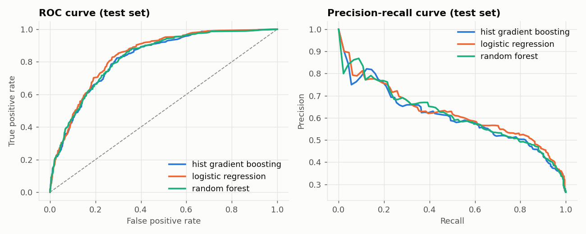
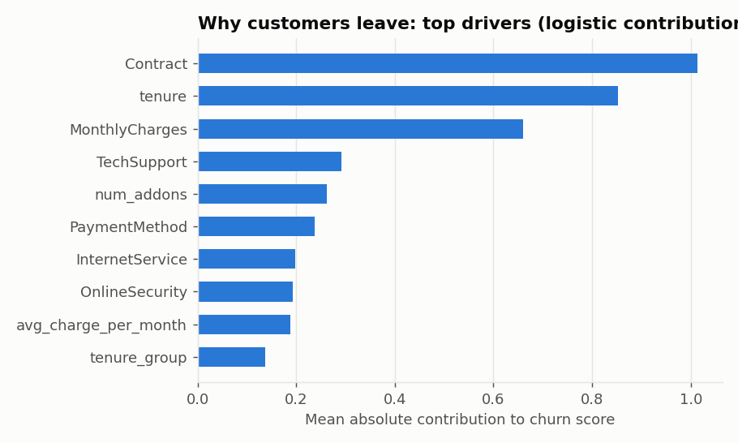
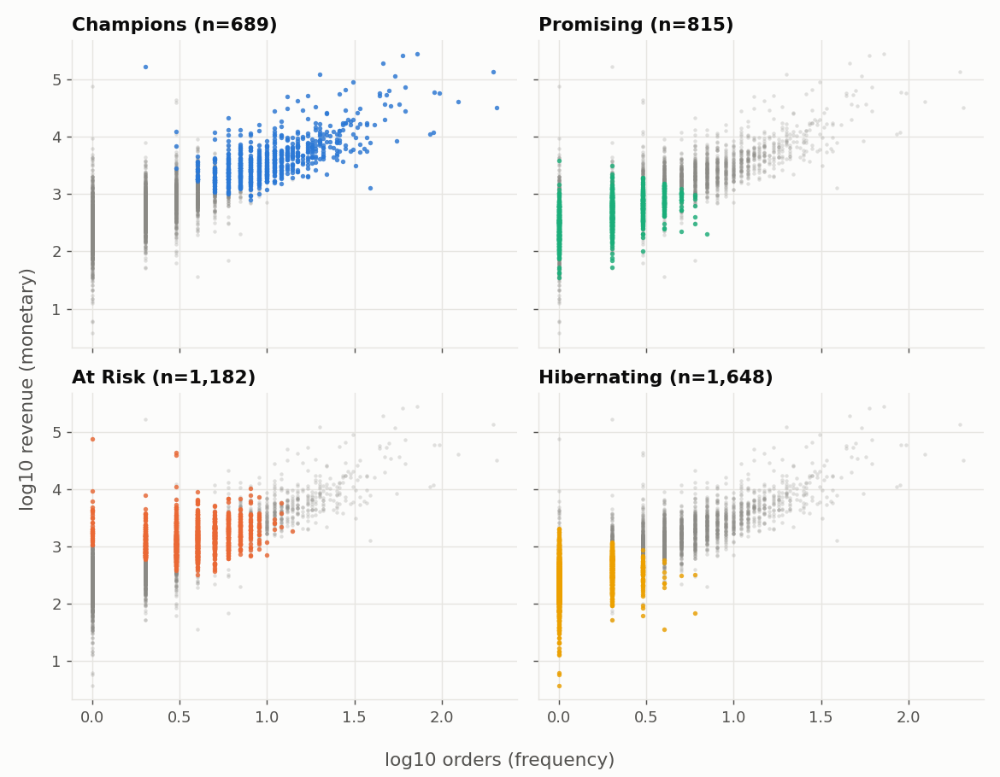
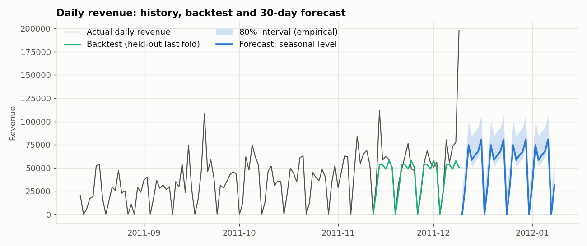

# MarketMind AI

**Customer churn prediction, revenue forecasting and business analytics: an end-to-end data science project.**

> **Explore the project:** [Project site](https://krushnamanke.github.io/marketmind-ai/) · [Deploy your Streamlit dashboard](https://share.streamlit.io/deploy?repository=KrushnaManke%2Fmarketmind-ai&branch=main&mainModule=app%2FHome.py) · [View the source](https://github.com/KrushnaManke/marketmind-ai)

[](https://www.python.org/)
[](https://streamlit.io/)



**A decision-support lab, not a black box.** Explore churn risk, explain model drivers, test a retention rule, compare customer segments, and inspect a 30-day forecast. The showcase includes an interactive retention-value calculator; the full dashboard has seven navigable pages.

### A few numbers from the included example run

| Churn analysis (synthetic Telco demo) | Retail analysis (UCI Online Retail) |
|---|---|
| 7,043 customer records | 541,909 source transactions |
| 26.4% historical churn rate | 4 customer segments |
| $787k estimated annual revenue at risk | 64.1% of observed revenue in the Champions segment |
| $18.5k expected-value policy net benefit on held-out customers | $1.54M example next-30-day revenue forecast |

These are reproducible outputs for the included example data, **not business guarantees**. The churn and retail datasets describe separate populations; the values are never joined into customer-level claims. The Telco rows and review texts are synthetic, while retail summaries come from UCI Online Retail. See [data sources and caveats](#data-and-interpretation).

One executive dashboard answers four questions:

| Question | How it is answered |
|---|---|
| **Which customers are likely to leave?** | Logistic Regression, Random Forest and XGBoost, with *calibrated, out-of-fold* churn probabilities |
| **Why are they leaving?** | SHAP (or exact logistic contributions) globally and per customer, churn by segment in SQL, review-sentiment themes |
| **How much revenue might we lose?** | `revenue at risk = churn probability x annual revenue`, plus a profit-based retention-campaign analysis |
| **What might happen next month?** | Rolling-origin backtested daily revenue forecast with empirical 80% intervals |

It also includes customer segmentation (RFM, K-Means, DBSCAN), customer lifetime value (Telco hazard model, Retail regression), SQL analysis and review sentiment (TF-IDF + Logistic Regression, optional DistilBERT).

> **Demo data notice.** The Telco churn rows and review texts are synthetic stand-ins with the expected schemas. The
> retail analysis uses the public UCI Online Retail dataset. The dashboard identifies source types and shows a warning
> whenever synthetic data is in use. Add compatible inputs to `data/raw/` (see below) and rerun the pipeline to update it.

---

## Quick start

```bash
python -m venv venv && source venv/bin/activate        # Windows: venv\Scripts\activate
pip install -r requirements-train.txt                  # full environment

python -m src.pipeline                                 # ~1 minute: data -> SQL -> models -> forecast -> figures
streamlit run app/Home.py                              # open the dashboard
python tests/test_project.py                           # unit + output tests
```

`make pipeline`, `make app`, `make test` do the same. Run only some steps with `python -m src.pipeline --only churn forecast`.

### Use the real datasets

| Module | Dataset | Save as |
|---|---|---|
| Churn, CLV | IBM Telco Customer Churn (Kaggle) | `data/raw/telco.csv` (the original `WA_Fn-UseC_-Telco-Customer-Churn.csv` name also works) |
| Retail, forecasting, segments | UCI Online Retail | `data/raw/Online Retail.xlsx` (or `online_retail.csv`; the newer "Online Retail II" column names are normalised) |
| Sentiment | Any review set, e.g. IMDB 50K | `data/raw/reviews.csv` with columns `text,label` (1 = positive). `review,sentiment` also works |

`python -m src.download_data` tries to fetch them for you (needs internet; it prints manual links if a download fails).
Re-run `python -m src.pipeline` afterwards. No code changes needed.

### Data and interpretation

* **Telco churn:** synthetic records following the public IBM Telco Customer Churn schema; no real customer data is included.
* **Reviews:** synthetic demo text. It is not evidence about the Telco population.
* **Retail:** UCI Machine Learning Repository's [Online Retail](https://archive.ics.uci.edu/dataset/352/online+retail) dataset (2010–2011). The source workbook is not committed; only processed project outputs are included. Citation: Daqian Chen, Sai Laing Sain, and Kegan Guo, “Data mining for the online retail industry: A case study of RFM model-based customer segmentation using data mining,” *Journal of Database Marketing & Customer Strategy Management*, 19, 197–208 (2012).

Estimates depend on the dataset and assumptions in `src/config.py`. They are descriptive and predictive—not causal impact estimates or financial advice. See [Limitations](#limitations-say-these-in-interviews) before applying them to a real campaign.

---

## Project structure

```
marketmind-ai/
├── data/raw/                  # your real files go here (git-ignored)
├── data/processed/            # every table/JSON the dashboard reads (committed, small)
├── sql/analysis.sql           # 10 named business queries (window functions, cohorts, NTILE)
├── src/
│   ├── config.py              # paths + ALL business assumptions (edit these)
│   ├── data_sources.py        # real file if present, else synthetic; cleaning rules
│   ├── make_synthetic.py      # schema-identical demo data
│   ├── load_db.py / run_sql.py# CSV -> SQLite, then run sql/analysis.sql -> CSVs
│   ├── features.py            # feature engineering + preprocessing (inside the Pipeline)
│   ├── churn.py               # models, calibration, targeting, explanations, revenue at risk
│   ├── clv.py                 # Telco hazard CLV + Retail next-90-day regression
│   ├── segmentation.py        # RFM, K-Means, DBSCAN
│   ├── forecast.py            # backtested forecasting
│   ├── sentiment.py           # TF-IDF + LR, themes   (sentiment_bert.py = optional transformer)
│   ├── report_figures.py      # PNGs for this README
│   └── pipeline.py            # runs everything
├── app/                       # Streamlit: Home.py + pages/1..6
├── models/                    # churn_model.joblib, sentiment_tfidf_lr.joblib
├── tests/                     # test_project.py, smoke_app.py
├── reports/figures/            # regenerated model and forecast visuals
└── site/                       # GitHub Pages interactive project showcase
```

---

## What each stage does, and why

### 1. SQL (`sql/analysis.sql`)
Churn by contract / tenure band / payment method / internet+support, MRR concentration by decile (`NTILE`), monthly
revenue with month-over-month growth (`LAG`, running `SUM() OVER`), top customers, country revenue, **cohort retention**,
repeat-purchase rate. Cleaning rules live in the queries too (cancellations are invoices starting with `C`; quantity and price must be positive).

### 2. Churn (`src/churn.py`)
* **Leakage-safe**: scaling and one-hot encoding are inside a scikit-learn `Pipeline`, fitted on training data only.
* **Model selection on the training split** (5-fold CV, PR-AUC). The test set is used once, for reporting.
* **Metrics for imbalance**: ROC-AUC, PR-AUC, precision/recall, Brier score; never plain accuracy.
* **Calibration**: `class_weight` / `scale_pos_weight` make probabilities too high. The final model is wrapped in
  `CalibratedClassifierCV`, so *summing probabilities gives a meaningful revenue figure* (checked: predicted vs actual churner count in `churn_summary.json`).
* **Out-of-fold scores** for every customer, so nobody is scored by a model that saw their label.
* **Targeting by expected profit, not by 0.5**: contact a customer when `p x save_rate x margin x annual_revenue > offer_cost`.
  The dashboard compares this with *contact nobody / everyone / top 20% / tuned threshold* on held-out customers.
* **Explanations**: SHAP `TreeExplainer` when `shap` and a tree model are available; otherwise exact additive contributions
  (coefficient x standardised value) of the logistic model. Each customer gets their top-3 risk reasons in plain words.

### 3. Revenue at risk and CLV
* Revenue at risk (12 months) = `churn_prob x MonthlyCharges x 12`, summed over **active** customers.
* Telco CLV: contract-level monthly hazard (`events / customer-months`, the maximum-likelihood estimate with censoring) -> discounted, horizon-capped expected revenue.
* Retail CLV: features measured **before a cutoff**, target = spend in the next 90 days; compared with a naive run-rate baseline (MAE, RMSE, top-decile capture).
  Selected by MAE because a few wholesale "whales" dominate RMSE; if the ML models do not beat the baseline the table says so.

### 4. Segmentation (`src/segmentation.py`)
RFM -> log transform -> standardise -> K-Means (k=4, chosen for interpretability; elbow and silhouette for k=2..8 are shown in the app) -> named by centroid:
**Champions, Promising, At Risk, Hibernating**. DBSCAN (eps from the k-distance curve) flags unusual customers that K-Means would force into a cluster.
Retail has **no churn label**, so `lapsed = no purchase in 90 days` is a *derived* definition and is labelled as such everywhere.

### 5. Forecasting (`src/forecast.py`)
Daily revenue (cancellations and fee pseudo-products removed). Always-available models: seasonal-naive and seasonal-level
(recent level x day-of-week index). If installed, Holt-Winters, SARIMAX and Prophet join automatically. All models are compared on the
**same three rolling 28-day holdouts**, ranked by WAPE (robust to zero-sales days; MAPE is not). Intervals are empirical quantiles of the pooled
backtest residuals so that every model gets a comparable, honest band. About one year of history cannot reveal annual seasonality, and the app says so.

### 6. Sentiment (`src/sentiment.py`)
TF-IDF (1-2 grams) + Logistic Regression, F1 / accuracy / ROC-AUC, most informative terms, and keyword **themes** (price, support, delivery, quality, network).
Reviews are a *separate* dataset: themes show which topics dominate negative feedback, **not** why a specific Telco customer left. `src/sentiment_bert.py`
adds DistilBERT (zero-shot or fine-tuned) for a side-by-side F1; it is optional and never imported by the dashboard.

---

## Example results (synthetic demo data)

| Item | Result |
|---|---|
| Churn models, test ROC-AUC | Logistic 0.837, Random Forest 0.827, Gradient Boosting 0.824 |
| Best (selected by train-CV PR-AUC) | Logistic regression; calibrated test PR-AUC 0.62, Brier 0.14 |
| Calibration check | predicted churners 1,864 vs actual 1,862 |
| Targeting on held-out customers | Contact everyone: **loses** money. Expected-value rule: best net benefit, reaching 66% of churners with 422 contacts |
| Retail CLV (next 90 days) | Gradient boosting MAE $1.7k vs naive $1.9k, but naive has lower RMSE (whale customers) |
| Forecast | Seasonal-level wins; ~25% daily WAPE over three rolling folds |
| Sentiment | F1 0.85 (labels deliberately noisy in the synthetic set) |

Simple models matching boosted ones on Telco is normal (small, mostly-linear tabular data); the project reports it rather than hiding it.
With real data, expect ROC-AUC around 0.84 on Telco.





---

## Dashboard pages

1. **Executive Overview**: KPIs, revenue at risk by contract, churn by tenure, campaign value, segment share.
2. **Churn Risk**: filters, ranked customer list with top-3 reasons, CSV export, single-customer view, "score a hypothetical customer" form.
3. **Why They Leave**: global drivers, permutation-importance cross-check, SQL breakdowns, review themes, suggested playbook.
4. **Segments & Lifetime Value**: segment profiles, per-segment scatter panels, k diagnostics, cohort heatmap, CLV model table and top customers.
5. **Revenue Forecast**: history, backtest, 30-day forecast with band, model comparison.
6. **Review Sentiment**: model quality, informative terms, live scoring box, review browser.
7. **SQL Insights**: every saved query with its SQL, plus a read-only query box.

The app only *reads* precomputed files from `data/processed/`, so it starts instantly and needs no heavy libraries at runtime.

### Deploy the dashboard: Streamlit Community Cloud
1. Run the pipeline locally; commit `data/processed/`, `models/`, `reports/` (not `data/raw/`, not `marketmind.db`).
2. Push to GitHub and [deploy this repository to Streamlit Community Cloud](https://share.streamlit.io/deploy?repository=KrushnaManke%2Fmarketmind-ai&branch=main&mainModule=app%2FHome.py). Sign in with your GitHub account and confirm `app/Home.py` as the main file. Streamlit installs `requirements.txt` (lean runtime).
3. Keep the library versions in `requirements.txt` close to the ones you trained with. Pickled models are version-sensitive; if loading fails
   the scoring forms show a message and the rest of the app still works.

The public GitHub Pages site at [krushnamanke.github.io/marketmind-ai](https://krushnamanke.github.io/marketmind-ai/) is the project overview and deploy guide; GitHub Pages cannot run Python. The interactive dashboard is your Streamlit app, deployed separately from this repository. The deploy button opens Streamlit Community Cloud; sign in and complete its setup to receive your app's live URL. No Streamlit-hosted app URL is claimed until that setup is complete.

---

## Testing: what is and is not verified

* `python tests/test_project.py`: 13 tests (cleaning rules, leakage check on the preprocessor, CLV logic, business-rule maths, SQL parsing,
  output sanity: probabilities in [0,1], calibration within 5%, ordered intervals, all segments present).
* `python tests/smoke_app.py`: runs every dashboard page against stubbed Streamlit/Plotly and checks that every referenced column exists.
  It does **not** validate real Streamlit/Plotly behaviour or layout, so do a visual pass with `streamlit run app/Home.py`.
* **The pipeline was built and run with only pandas, scikit-learn and sqlite3 available.** Code paths that need `xgboost`, `shap`, `statsmodels`,
  `prophet`, `transformers` activate automatically when those libraries are installed but have not been executed by the author.
  If one misbehaves in your environment, the pipeline prints which model failed and falls back to the always-available models.

## Limitations (say these in interviews)

* The Telco label means "left in the last month". Applying a risk score to customers who are still active treats the label as the eventual outcome; a production
  system needs dated snapshots (customer state at month t, churn at t+1).
* Out-of-fold probabilities are calibrated on this dataset; recalibrate on new data.
* Revenue-at-risk and campaign value depend on the assumptions in `src/config.py` (margin, offer cost, save rate). Change them and re-run.
* Retail has no churn label (derived 90-day flag); its customers and the Telco customers are different populations and are never merged.
* About a year of daily history cannot support annual seasonality; the forecast is short-term.

## Ideas to extend

Survival analysis (`lifelines`) for Telco CLV; uplift modelling for who is *persuadable*; BG/NBD + Gamma-Gamma (`lifetimes`) as a retail CLV baseline;
fine-tuned DistilBERT with topic modelling; an automated monthly retrain via GitHub Actions.

## Resume bullets (replace with your real numbers)

* Built an end-to-end churn analytics platform (SQL, scikit-learn/XGBoost, SHAP, Streamlit) with calibrated probabilities (ROC-AUC 0.8x on held-out data).
* Quantified **$X of annual revenue at risk** and showed that an expected-profit targeting rule beats contacting everyone by **$Y** on held-out customers.
* Segmented N retail customers with RFM + K-Means/DBSCAN, and backtested a 30-day revenue forecast on rolling holdouts (WAPE Z%).
